# Michil — feature inventory

Portfolio source notes for [tathirmichil.com](https://tathirmichil.com). Captured while signed in on **1 November 2026**. Numbers below are a snapshot of production that day, so they will drift.

Michil is a multi-program admission-prep platform for University of Dhaka IBA and sibling exams (BUP, JU IBA, DU B unit, DU C unit). Students get a pixel-art study site: free diagnostics, topic practice, scheduled live tests, real-time challenge rooms, class materials, a coin economy, and an offline mock circuit. Staff get a full content, membership, and exam-ops console.

The visual system is eight-bit on purpose: block type, clipped corners, a green / beige / maroon palette, and a site-wide font switcher (Sans serif, Arial, Bloxat, Nova Square, Roboto Mono, Roboto Slab).

Screenshots live in [`screenshots/`](screenshots/). Student emails on admin chrome were replaced with “Account” before saving. Leaderboard names were replaced with “Student N”. Your own display name still appears in the student header on the shots taken from this login. Crop that chip before you publish a shot.

---

## Snapshot (1 Nov 2026)

| | |
|---|---|
| Accounts | 11,886 (11,865 students, 13 instructors, 8 admins) |
| New signups | 23 today, 158 this week |
| Subscribed students | 312 (317 subscribed accounts of any role) |
| People who have taken a test | 7,220 |
| Tests submitted | 82,524 |
| Question bank | 47,947 regular items, 580 passage sets; 14,016 of those belong to the IBA unit |
| Practice tests in the builder | about 1,381 (student catalog shows the visible subset: 173 Math, 128 English, 74 Analytical, 32 Miscellaneous) |
| Michilcoins in circulation (admin) | 1,561,914 |
| IBA coin leaderboard | 228 ranked students, average balance 6,400, top balance 20,572 |

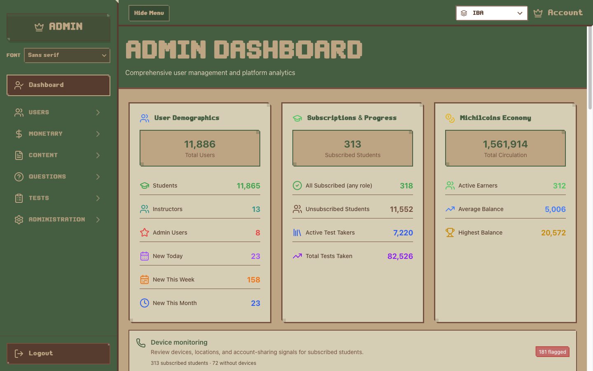

---

## Screenshot index

| File | What it shows |
|---|---|
| [01-admin-dashboard.png](screenshots/01-admin-dashboard.png) | Staff home: headcount, subscriptions, coin circulation |
| [02-home-hero.png](screenshots/02-home-hero.png) | Public homepage |
| [04-batch.png](screenshots/04-batch.png) | Personal batch landing and apply steps |
| [05-crash.png](screenshots/05-crash.png) | Crash batch hero |
| [05b-crash-flow.png](screenshots/05b-crash-flow.png) | Crash batch contents and four-step flow |
| [06-book.png](screenshots/06-book.png) | IBA Book product page |
| [07-blogs.png](screenshots/07-blogs.png) | Public blog index |
| [08-offline-mocks.png](screenshots/08-offline-mocks.png) | Offline mock program |
| [09-classes.png](screenshots/09-classes.png) | Class syllabus |
| [10-subscription.png](screenshots/10-subscription.png) | Student subscription and bKash checkout |
| [11-test-hub.png](screenshots/11-test-hub.png) | Test area and practice catalog |
| [12-practice-tests.png](screenshots/12-practice-tests.png) | Topic practice progress |
| [13-live-tests.png](screenshots/13-live-tests.png) | Scheduled live tests |
| [14-challenge-tests.png](screenshots/14-challenge-tests.png) | Real-time challenge lobbies |
| [15-assessment-tests.png](screenshots/15-assessment-tests.png) | Free assessment catalog |
| [16-student-overview.png](screenshots/16-student-overview.png) | Student home and performance |
| [17-history.png](screenshots/17-history.png) | Attempt history and score trend |
| [18-result-analytics.png](screenshots/18-result-analytics.png) | Result breakdown |
| [19-materials.png](screenshots/19-materials.png) | Class videos and PDFs |
| [20-leaderboard.png](screenshots/20-leaderboard.png) | Coin leaderboard |
| [21-admin-questions.png](screenshots/21-admin-questions.png) | Question bank search |
| [22-admin-manage-tests.png](screenshots/22-admin-manage-tests.png) | Test manager |
| [23-admin-economy.png](screenshots/23-admin-economy.png) | Coin prices and gates |
| [24-admin-units.png](screenshots/24-admin-units.png) | Programs, prices, crash, applications |
| [25-admin-question-editor.png](screenshots/25-admin-question-editor.png) | Question editor |
| [26-admin-offline-mocks.png](screenshots/26-admin-offline-mocks.png) | Offline mock operations |
| [27-admin-sections.png](screenshots/27-admin-sections.png) | Sections and topics |
| [28-announcements.png](screenshots/28-announcements.png) | Student announcements |
| [29-mistakes.png](screenshots/29-mistakes.png) | Redo-your-mistakes builder |
| [30-schedule.png](screenshots/30-schedule.png) | Class and test schedule |

---

## 1. Public site

### Homepage

Pixel-art landing page. Logged-in visitors get shortcuts into the student dashboard, the admin console, and the application.

The page continues into a feature grid (Blogs, Batch, Crash, Test, Book, Mock), a free assessment pitch, the book, the personal batch, an about section, student testimonials from recent IBA batches, and community links (Facebook group, chat, Instagram).

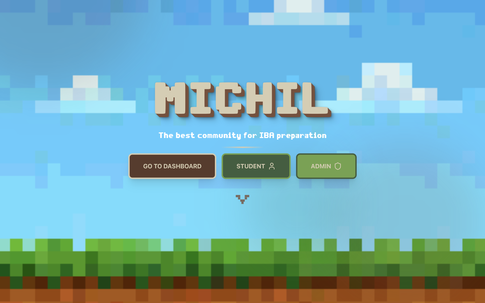

### Blogs

Public articles on starting IBA prep, whether to sit the exam, the syllabus, the crash batch, FAQs, and unit-specific prep (DU B, DU C from business and science backgrounds). Each card can be shared. The index paginates with “Load more”.

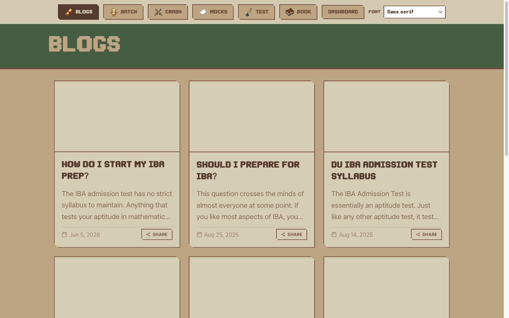

### Personal batch

Marketing page for the long batch: a small cohort, a mentor, classes, and practice tests. The apply path is three steps — create an account, fill the form, then subscribe after acceptance. Applying is free and does not require an assessment.

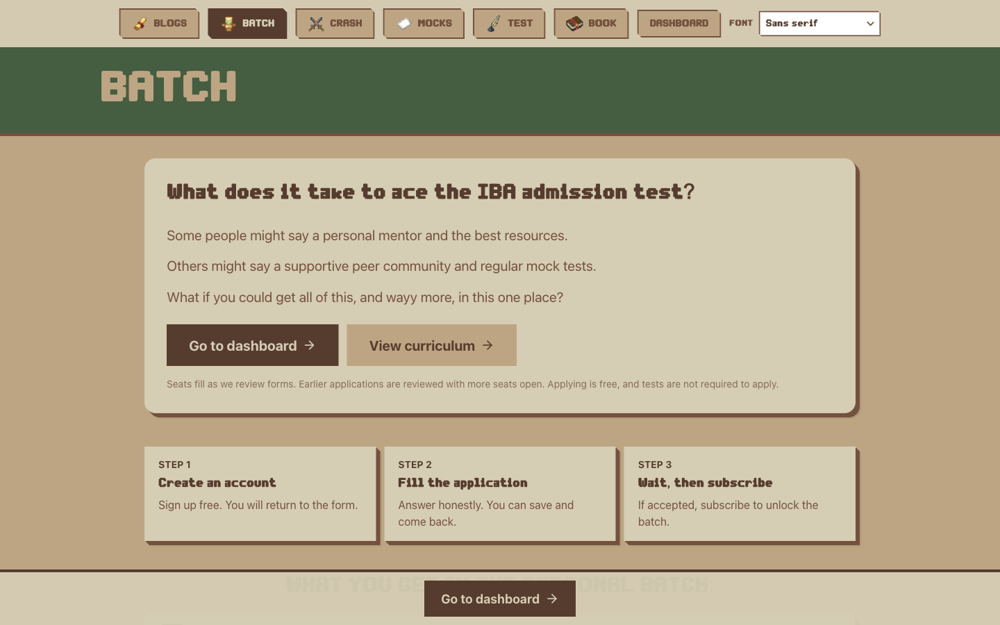

### Crash batch

Short intensive batch. The public page advertises 8+ live classes, 10+ recorded classes, 20+ topic PDFs, 200+ topic practice tests, and 20+ live tests. The study loop on the page is Learn, Practise, Test, Improve.

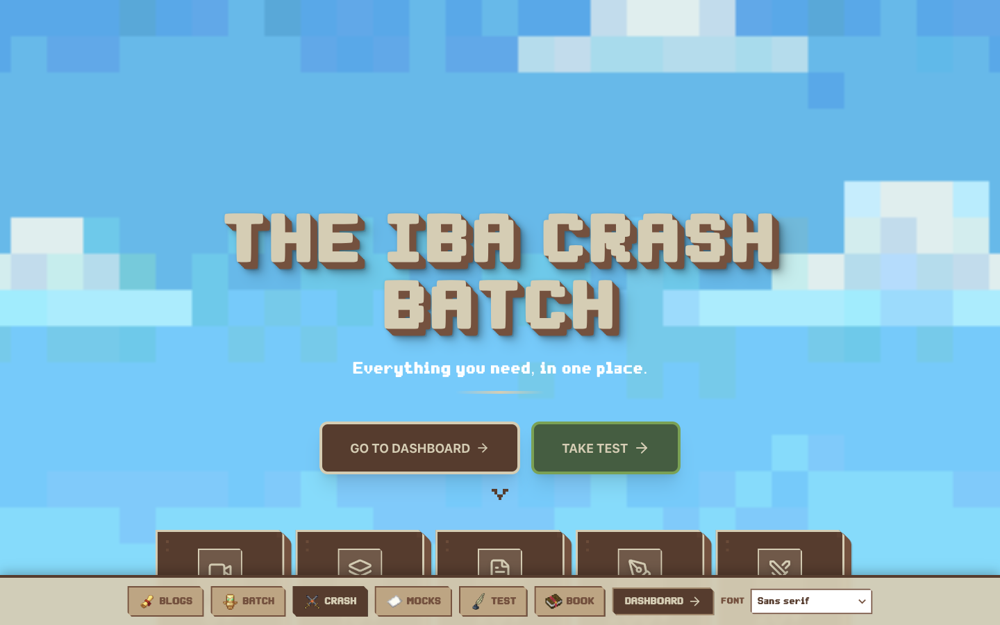

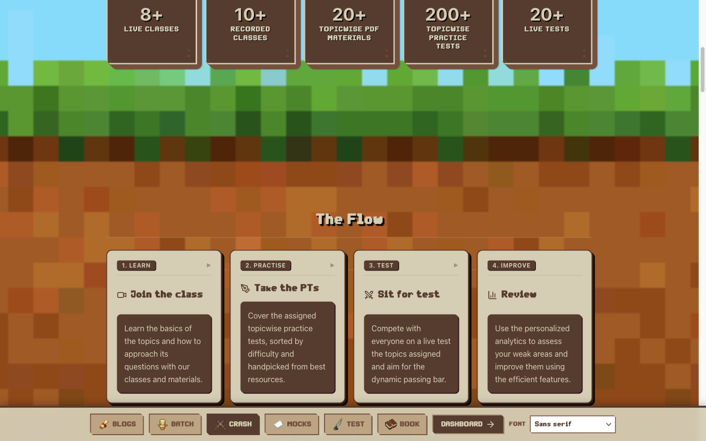

### Classes

Public syllabus of the live course: orientation, math fundamentals, grammar, word problems, numbers, percentage, vocabulary, error detection, sentence correction, puzzles, ratio and mixture, speed, permutation and probability, geometry, critical reasoning, reading comprehension, paragraph questions, data sufficiency, writing, and exam-hall strategy. The page states about 2 hours a class, 2 classes a week, online on Zoom, with a few evening slots.

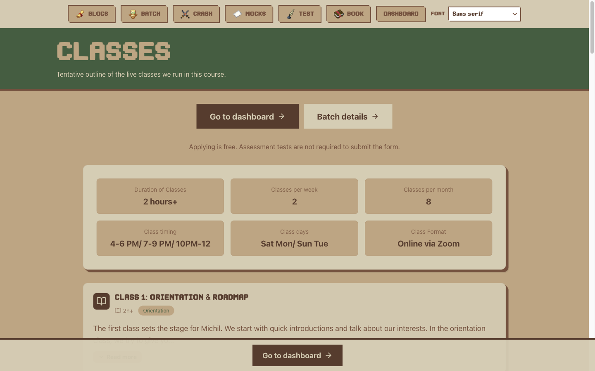

### The IBA Book

A physical book sold on the site. On capture day the page showed ৳800, 40+ chapters, 60+ practice sets, and 1500+ questions. Checkout options are cash on delivery, bKash, and gifting a copy. Delivery is priced inside Dhaka, Dhaka suburban, and outside Dhaka. Buyers can track an order and report a delivery problem. The page also covers what is inside, specs, what changed in the edition, and an FAQ.

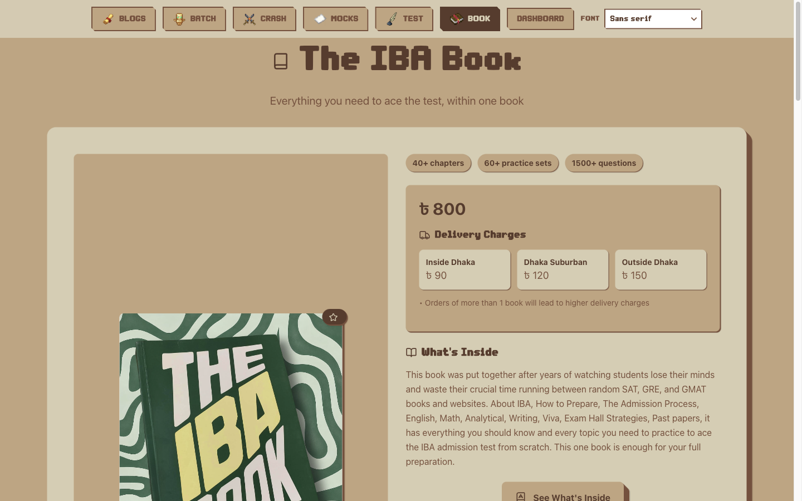

### Offline mock program

A seasonal circuit of full-length mocks, separate from the online subscription. The public page describes 10 offline papers, 10 online papers, and one centralized grand exam, with topic analytics and a large candidate pool. Centres are listed across Dhaka and Chittagong (Farmgate, Mohammadpur, Dhanmondi, Uttara, Bailey Road, Mirpur 10, Chittagong), some marked full. The listed subscription was ৳5,000 once. A dated schedule runs from early November through the IBA exam.

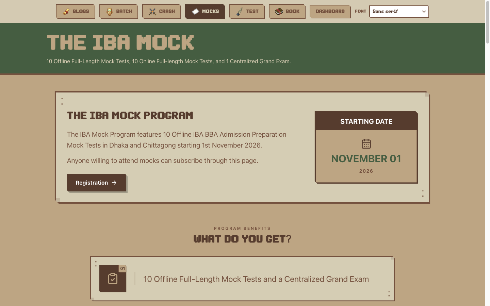

### Other public pieces

- Application form per program (`/form`), plus a crash-specific form.
- Login and signup.
- Privacy policy, terms, and email unsubscribe.
- Shared result links so a student can show a score without opening the whole account.

---

## 2. Tests

Four modes sit behind one test navigation: Assessment, Practice, Live, Challenge. The active program is chosen with a unit switcher (IBA in these shots).

### Free assessments

Ungated diagnostics built like recent IBA papers. The catalog on capture day included full-length 90-minute / 70-question papers and shorter section papers (math, English, analytical). Cards show attempt state, score, and a share action. The homepage pitches a 90-minute paper that needs no prior prep, then reports accuracy, a section breakdown, and a comparison with other takers.

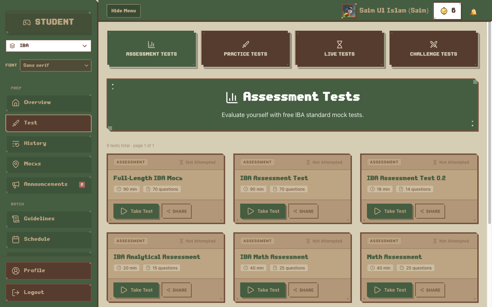

### Topic practice

Handpicked sets grouped by section. Progress is a completed / total bar (Math 173, English 128, Analytical 74, Miscellaneous 32 in the visible IBA catalog). Topics open under each section. Sets are ordered by difficulty. This is the day-to-day practice loop of the course.

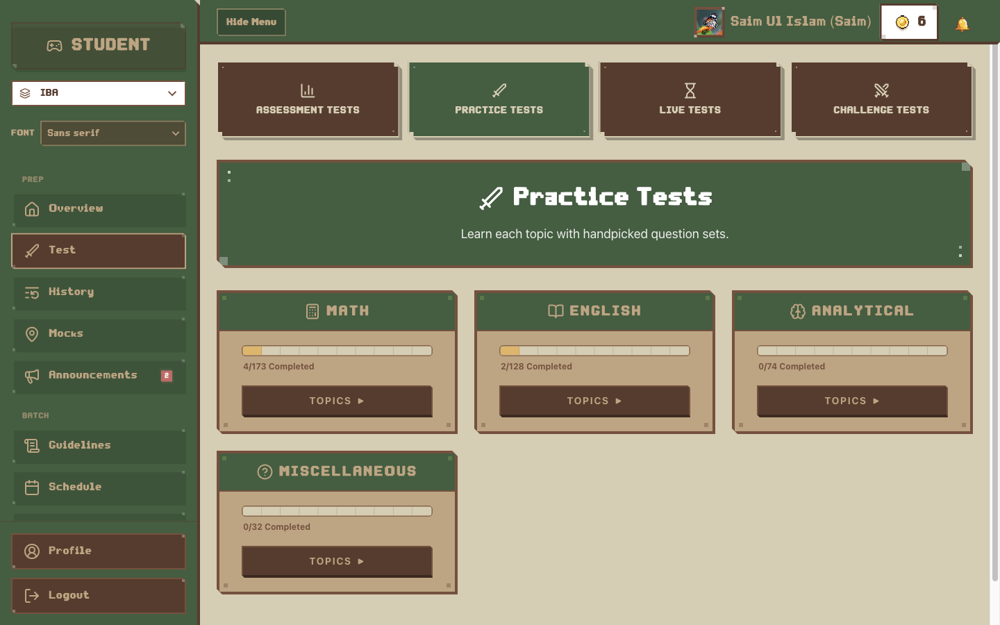

### Live tests

Scheduled exams with a leaderboard. Two shelves: open-to-everyone public lives, and batch lives. Each card shows duration, question count, start or end time, and whether the student attempted, missed, or can still enter. Finished papers link to a leaderboard and can be shared. On capture day the batch shelf included 90-minute IBA online mocks and a 60-minute “Rush” paper.

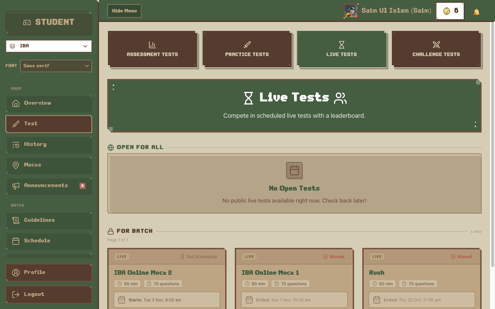

### Challenge tests

Real-time rooms. Creating a lobby is free. Playing costs Michilcoins (100 on the IBA unit when this was captured). Observers can be allowed in free. A student joins with a lobby code or from the active list. Past rooms show player count, observer count, duration, and whether you played or watched, with a results link.

A room moves through lobby, live play, and result. Phase changes are coordinated by a worker so clients are not the source of truth for when a round starts or ends.

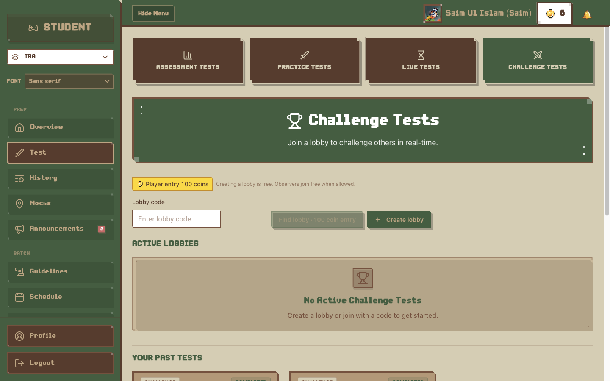

### Taking a paper

The player is a timed exam UI. Regular questions are standalone multiple choice. Passage questions (called comprehensive in the product) are a stem plus several sub-questions, each with its own options and score. Answers and time are stored as the student goes, including if they leave and come back on a live or challenge paper.

Scoring uses negative marking. The result shown below deducted 0.25 per wrong answer.

### Results

A result page reports overall score, attempted / correct / wrong / skipped, attempt rate, accuracy, and time per question. It then breaks the same stats down by section and by topic. Further tabs cover question-by-question review and section performance. Results can be shared.

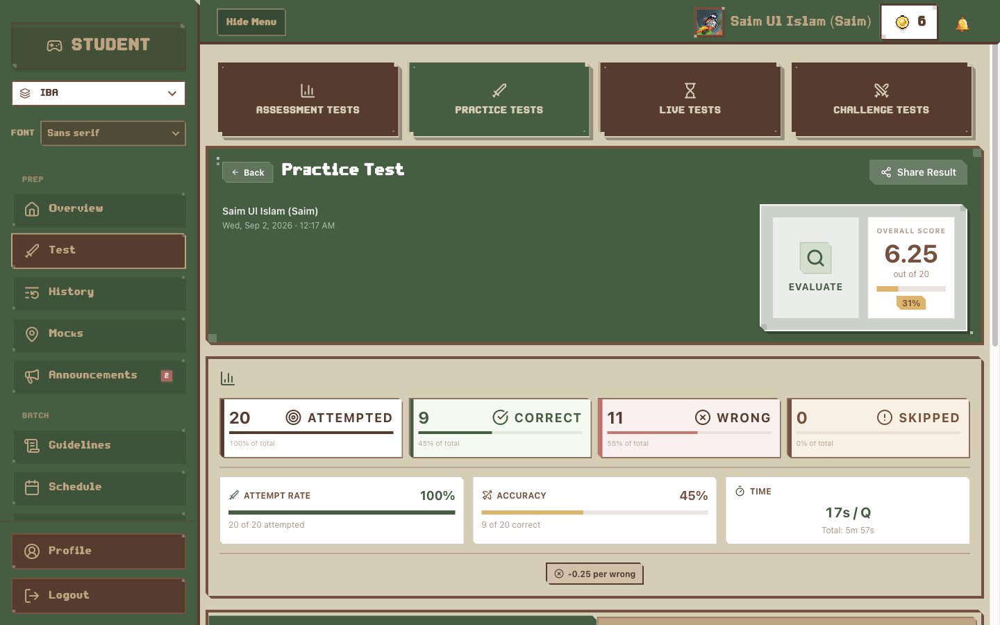

### History, mistakes, and skips

History lists every submitted paper with type, section, topic, time, date, and score. Filters cover test type (practice, live, public live, challenge), pass or fail, sort, section, and topic. A sparkline shows score percent over time. Mistakes and skipped questions are separate drills: pick a section and topic, choose 5 to 20 questions, and sit a generated paper. On capture day the mistakes pool had 134 items.

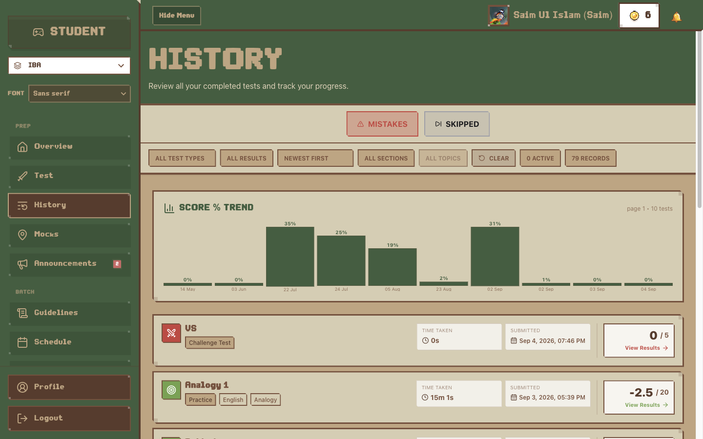

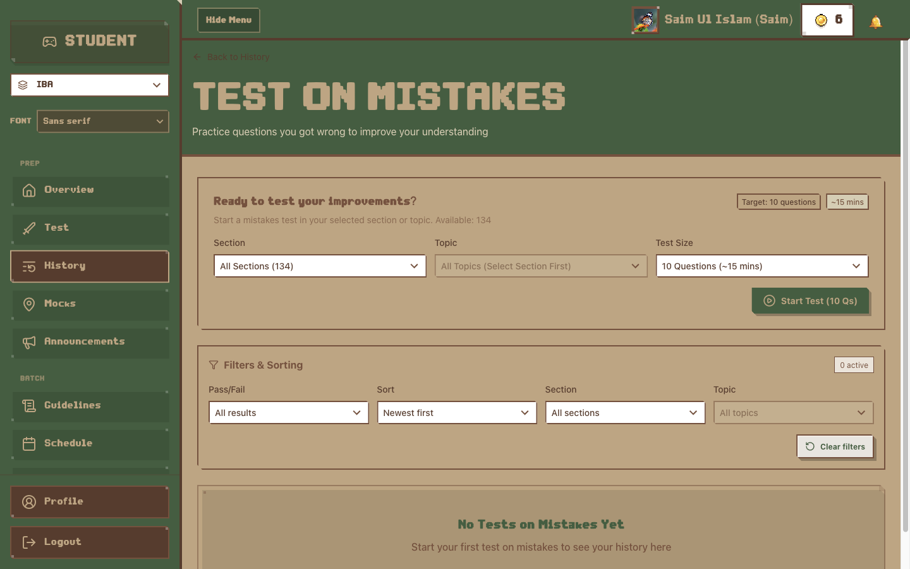

### Staff-side testing tools

Not all of these were screenshotted. They are in the admin and instructor consoles:

- Create a test and edit it later (title, timing, question set, visibility, batches, schedule).
- Hide or show a test. Copy a practice or live test into another program, which also copies its questions and lands the copy hidden.
- Evaluate submissions, including papers that need a human mark.
- Watch in-progress attempts.
- Browse every result, and open one student’s script.
- Per-test leaderboard.
- Print a paper and print an OMR sheet for offline sittings.
- Question reports filed by students, for staff to fix a bad item.

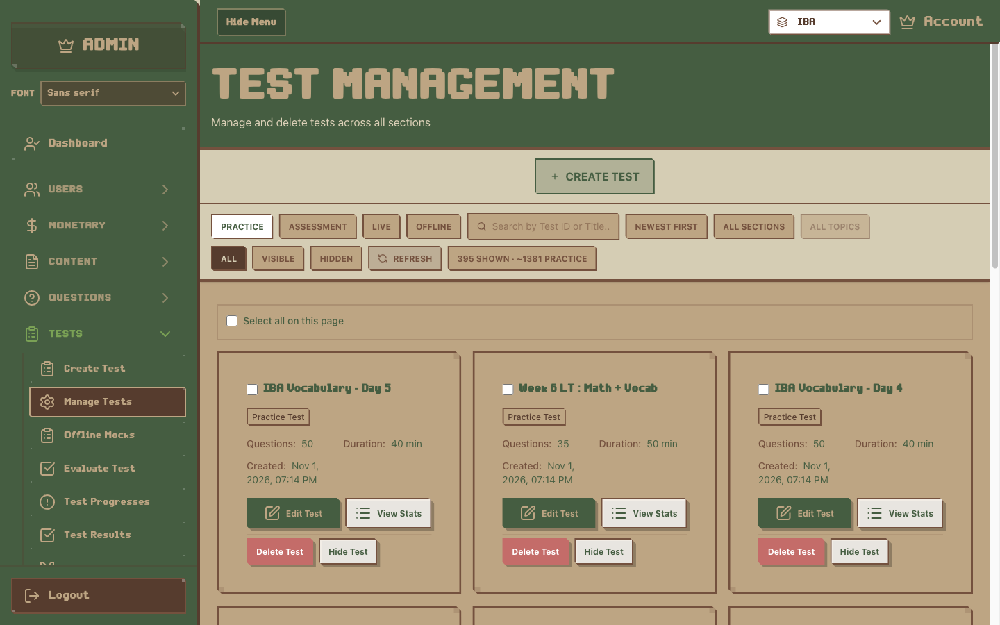

---

## 3. Student portal

The student shell is a sidebar: Prep (overview, tests, history, mocks, announcements, blogs), Batch (guidelines, schedule, materials, class links, session), and Account (application, subscription, leaderboard, reports, profile). A unit switcher sits at the top. The header shows the coin balance and notifications.

### Overview

Welcome line, quick actions (start practice, open materials), and a performance strip: overall score, attempt rate, accuracy, average time per question, and a level (the captured account was Level 2, Intermediate). Test progress is completed versus the catalog. Section cards rate Math, English, and Analytical, with accuracy, attempted, and average time. Topic cards sit underneath.

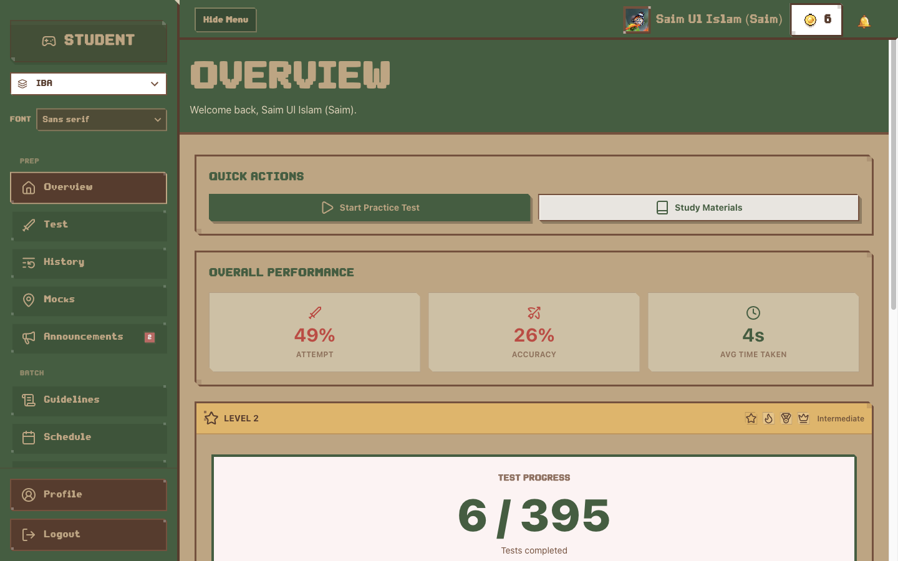

### Materials

Searchable library of class recordings and PDFs, tagged by topic (slides, formula sheets, writing notes, book corrections, and so on). Unlocking a video or a PDF spends Michilcoins. Prices are per program.

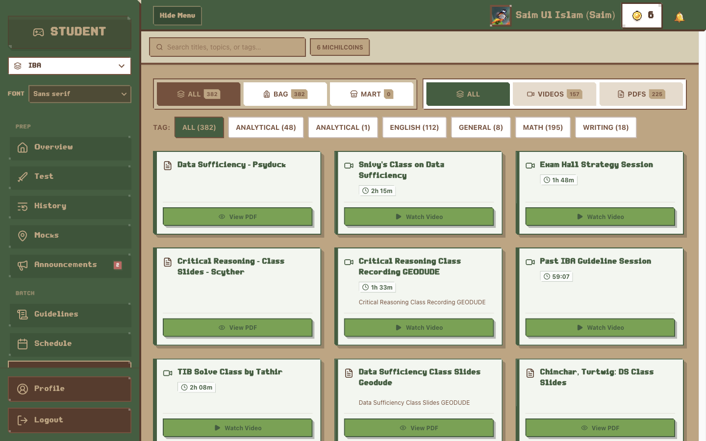

### Schedule

Unit-wide classes, tests, meetings, and events, as a list or a calendar, filterable by type. Batch-only items appear after a student is placed in a batch. Each row has a time window and a detail view.

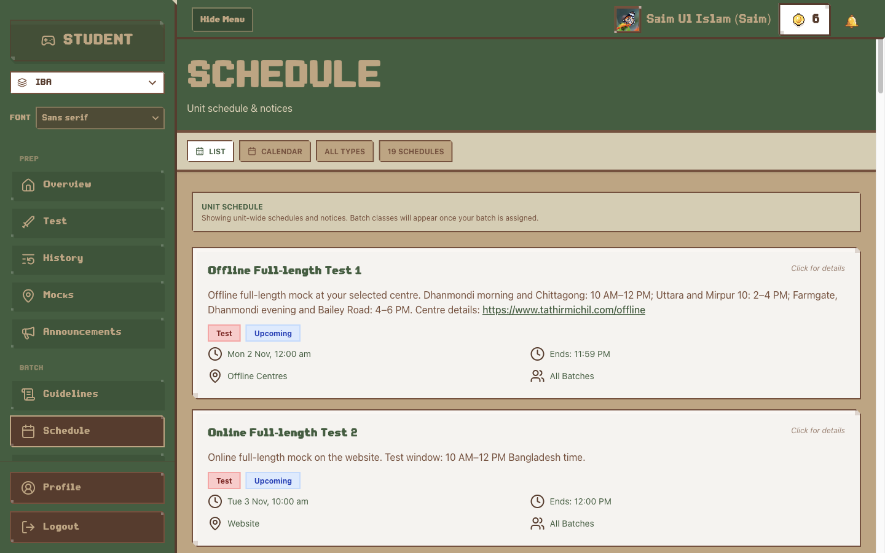

### Announcements

Posts scoped global, to one program, or to a batch. The captured inbox had a public mock-centre notice and a guideline-session notice.

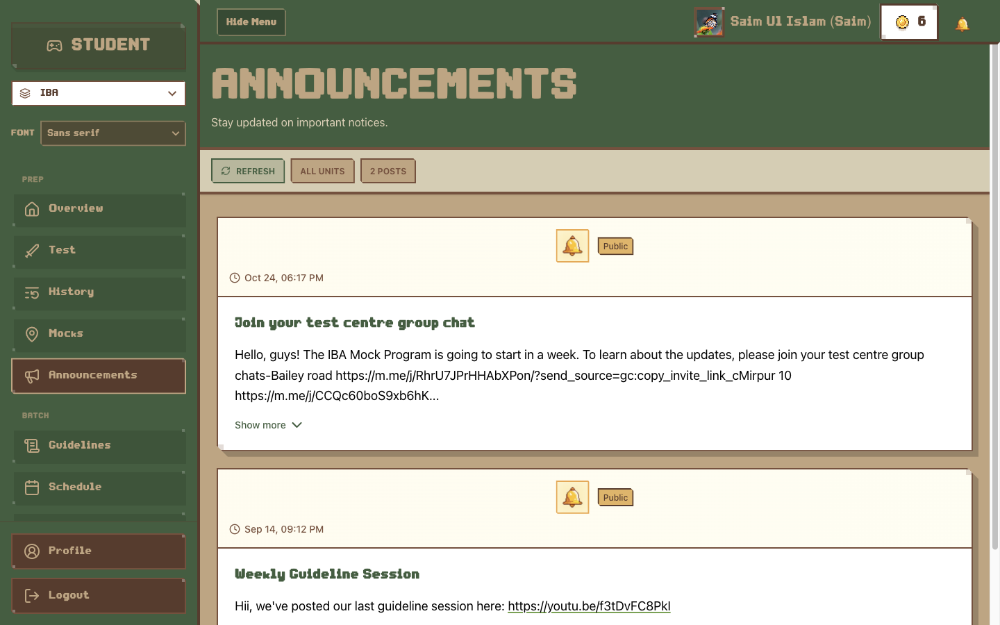

### Also in the student portal

- **Guidelines** — batch writeups the student can open one by one.
- **Class links** — Zoom or meet links for upcoming classes.
- **Session** — book a one-on-one. On the IBA unit that costs 3,000 coins.
- **Reports** — flag a bad question.
- **Application** — the admissions form for the active program.
- **Profile** — account details and profile photo. Photo changes can cost coins (the global price was 0 when captured).
- **Mocks** — the student’s offline-mock registration and upcoming centre.

---

## 4. Coins, subscriptions, and programs

### Programs (units)

Content and access are per program, not one global subscription. A student can hold more than one. The switcher on capture day listed IBA, C (Non-Business), BUP, B, C (Business), and JU IBA (hidden from the public unit list).

Staff edit each program’s monthly price, crash price and length, whether crash is on, whether an application is required, and whether another program’s subscribers get this one free.

Captured prices:

| Program | Regular | Crash | Notes |
|---|---|---|---|
| IBA | ৳10,000 / month | ৳8,000 for 4 months | Application required, crash on |
| C (Non-Business) | ৳4,000 / month | ৳4,000 for 4 months | Crash off; complimentary with IBA |
| BUP | ৳4,000 / month | ৳4,000 for 4 months | Crash off |
| B | ৳2,000 / month | ৳2,000 for 4 months | Crash off; complimentary with IBA |
| C (Business) | ৳4,000 / month | ৳4,000 for 4 months | Crash off; complimentary with IBA |
| JU IBA | ৳4,000 / month | ৳4,000 for 4 months | Hidden |

Renewal extends months. It does not switch plan mid-subscription. A subscribed student has exactly one batch inside that program, but a subscription still works before a batch is assigned.

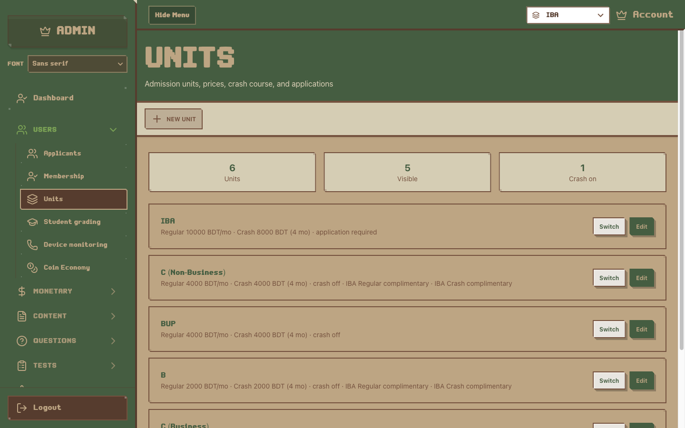

### Subscription checkout

The student page shows whether the active program has a pass, recent payments, and a bKash payment block. Checkout is tied to the program. There is a payment history page.

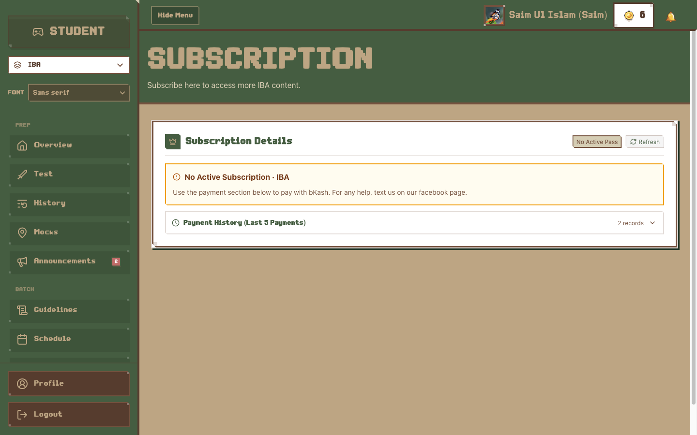

### Michilcoins

Coins are the in-product currency. Students earn them from tests and spend them on videos, PDFs, sessions, challenge entry, and profile photos. Balances update live. Staff can see circulation, average balance, and the richest wallet, and can gift or deduct on a program wallet.

IBA prices when captured: 80 coins per class video, 30 per class PDF, 3,000 per session booking. Book orders were open. Challenge entry was 100 coins. Staff also set the prepaid month range for a single bKash subscription payment, and the offline-mock season window.

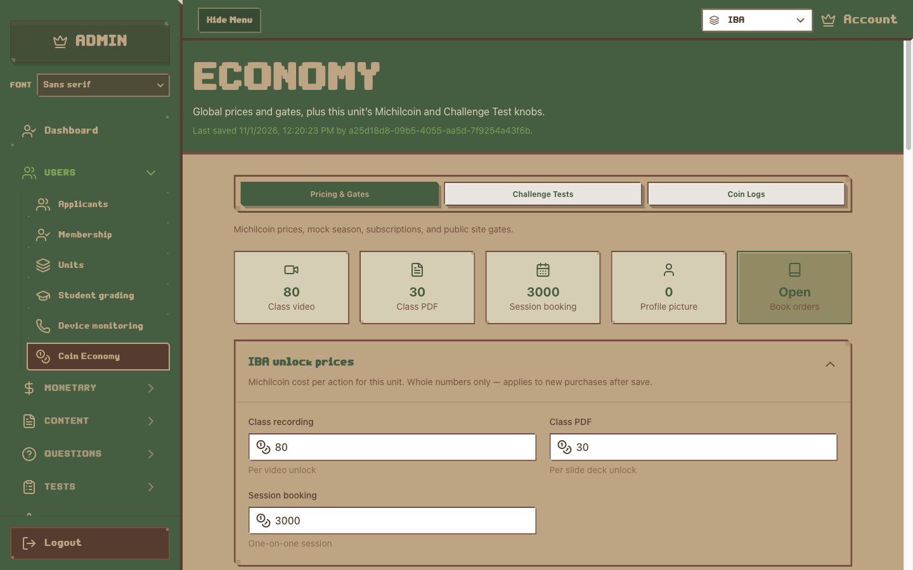

### Leaderboard

Public per visible program. Tabs for all-time, daily, and weekly, with the change since the previous night’s snapshot. Filters are the batch creatures used as batch names (Bulbasaur, Chimchar, Eevee, and the rest). Summary tiles show ranked students, average coins, top balance, and circulation. Names in the screenshot are placeholders.

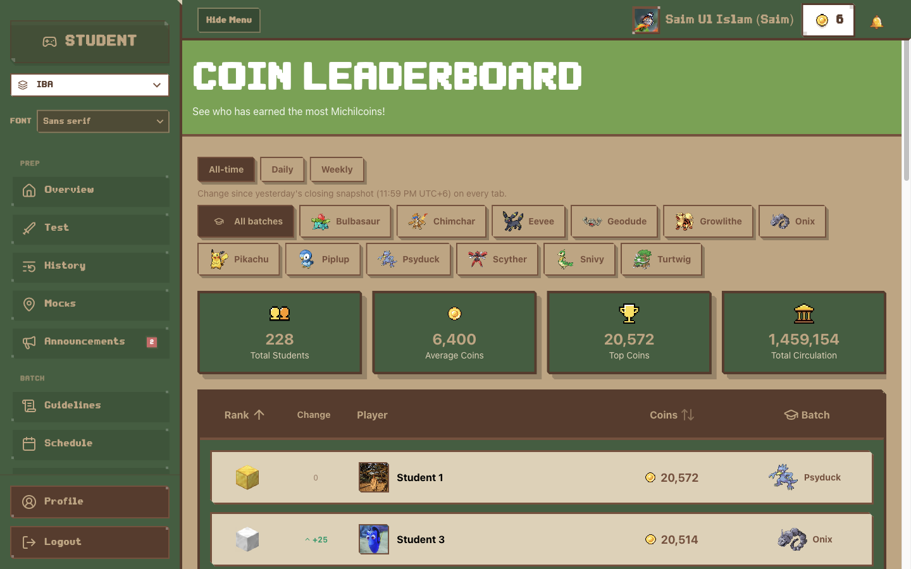

---

## 5. Admin console

Sidebar groups: Users, Monetary, Content, Questions, Tests, Administration. The same unit switcher scopes lists to one program.

### Users

- **Applicants** — people who submitted the program’s form, with review before they are offered a seat.
- **Membership** — who is subscribed, batch assignment, grant and revoke access.
- **Units** — the program editor above.
- **Student grading** — a per-student academic view, also available to instructors for their batches.
- **Device monitoring** — devices and locations on subscribed accounts, used to spot sharing. The dashboard tile on capture day: 312 subscribed students, 71 with no device, 182 flagged.
- **Coin economy** — prices, gates, and coin logs.

The dashboard itself is the user directory plus the headline stats in the first screenshot: search, role filter, subscription filter, and per-person actions. That table is full of personal data, so it was not saved as a portfolio image.

### Money

- **Payments** — subscription payment records.
- **Book settings** — price, delivery bands, whether orders are open.
- **Book orders** — fulfillment for cash-on-delivery and bKash book purchases, including gifts.

### Content

- Public blogs, with an editor.
- Guidelines.
- Form templates (one application form per program, plus the offline-mock form).
- Announcements.
- Class links.
- Schedules.
- Materials (the videos and PDFs students unlock).

### Questions

Two shapes of item:

- **Regular** — stem, options, one answer, explanation, section, topic, tags.
- **Comprehensive** — a passage or title, then ordered sub-questions that each have their own options and answer.

The editor is a rich-text composer (bold, lists, superscript, links) plus option rows with a correct-answer toggle. Staff can also upload a CSV of regular items or of passage sets. The bank browser filters by section, topic, how often an item has been used, and how often it is answered correctly. Students can file a report against an item; those land in Question Reports.

Sections and topics are per program. IBA had 19 sections, 3 active (Math, English, Analytical) and the rest inactive (GK, Bangla, subject papers for other units, and so on). Topics live under a section.

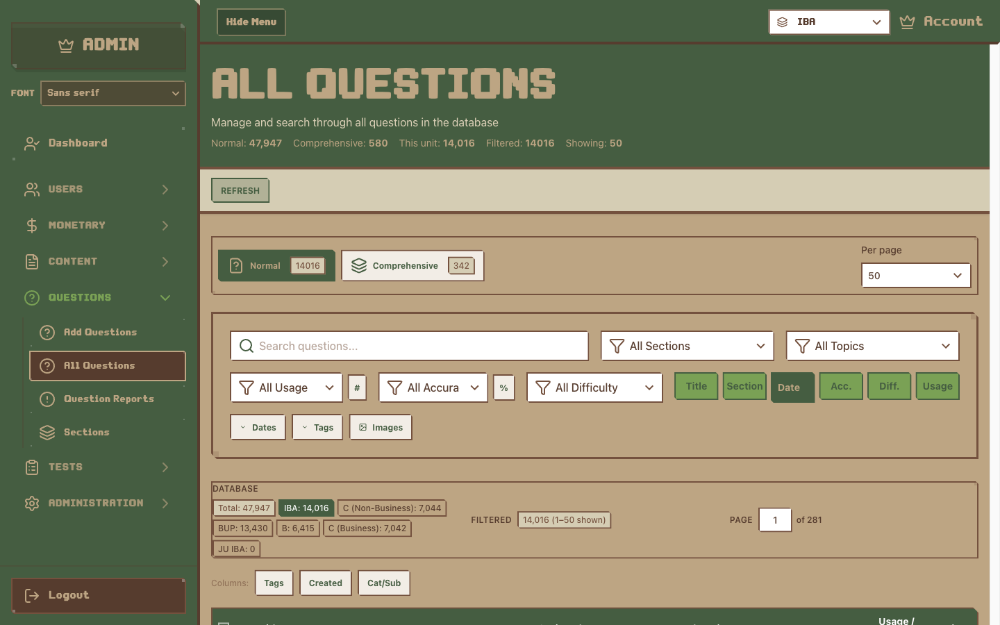

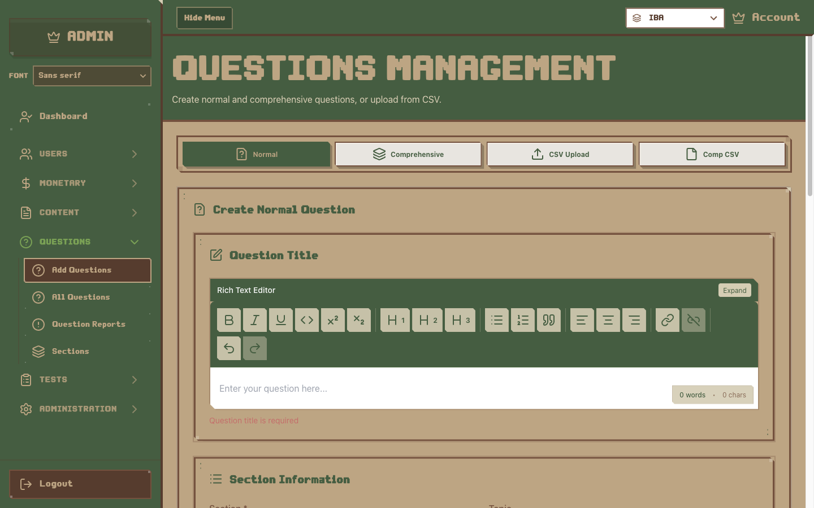

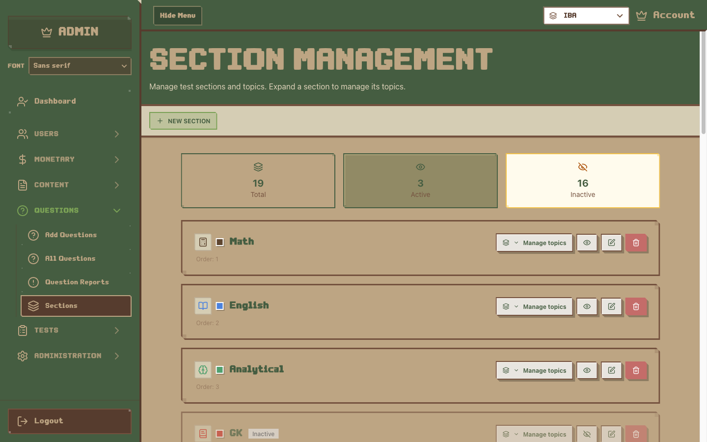

### Tests and offline ops

Covered in the test section above. The offline-mock desk is separate from the test builder: it tracks form registrations and bundle purchases, lists each paper’s centres and sittings, and links to candidates, centre management, paper editing, and print.

On capture day: 676 people registered through the form, 70 bought the bundle, 13 mock records. The grand exam listed sittings at Chittagong, Uttara, Bailey Road, Dhanmondi (morning and evening), Farmgate, Mirpur 10, and Mohammadpur.

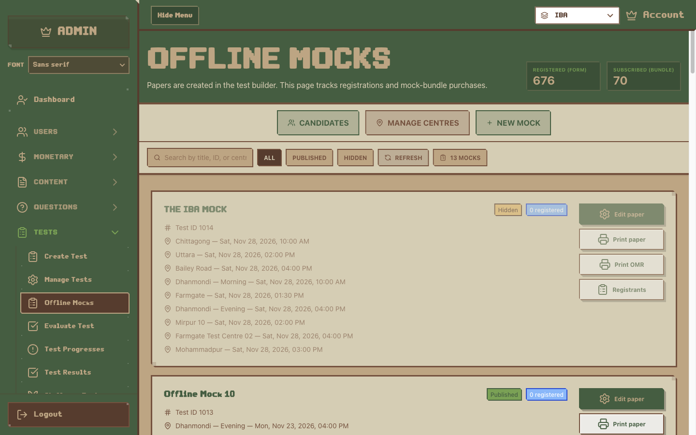

### Administration

- Instructor accounts.
- Create and manage batches (the named cohorts students get placed into).
- Internal reports.
- A mail test tool.
- A book-order test tool.

---

## 6. Instructor console

Instructors get a narrower version of the same tools, scoped to their batches:

- Student grading for their batches.
- Blogs, guidelines, form templates, announcements, class links, schedules, materials.
- Add and browse questions, question reports, sections.
- Create and manage tests, offline mocks, evaluation, live progress, results, challenge rooms, and sessions.

They cannot copy questions or tests across programs. That action is admin-only.

---

## 7. Platform behavior worth mentioning on a portfolio

These are product behaviors, not a stack tour. Use whichever sentences you want.

- **Three audiences.** Public visitors, students, and staff (admin and instructor), with different navigation and permissions.
- **Several programs on one site.** Questions, tests, batches, prices, coins, and leaderboards are scoped to the program in the switcher. Some programs can be hidden. Some can be included free with another subscription.
- **One exam engine, several paper types.** Assessment, practice, live, public live, challenge, and offline. Passage sets and single questions share a test but are stored and scored differently. A test’s length counts sub-questions, not just passages.
- **Live play.** Challenge rooms and in-progress answers update in real time. Coin balances do too. A background worker advances challenge phases; the browser does not.
- **Coins plus cash.** Michilcoins for unlocks and challenge entry. bKash for subscriptions, the book, and the offline-mock bundle. Cash on delivery for the book.
- **Batch operations.** Apply, get reviewed, get a batch, then see that batch’s guidelines, schedule, class links, and live tests. A subscription still unlocks the program before a batch exists.
- **Exam ops.** Printable papers, OMR sheets, centre capacity, registration versus paid bundle, human evaluation, and per-test leaderboards.
- **Integrity.** Question bodies are not readable from the public database by a signed-in student; the take page and the result review each go through their own access path. Subscribed accounts can be reviewed for shared devices.
- **Authoring at volume.** Tens of thousands of items, CSV import, usage and accuracy filters, student-filed corrections, and copy-into-another-program for practice and live papers.
- **Design.** The whole product, including admin, uses the same pixel UI rather than a separate dashboard kit.

---

## What was not screenshotted

Left out on purpose, mostly because the screen is a list of other people’s names, emails, phones, or payment rows:

- Applicant review, membership editor, payment ledger, book orders.
- Device-monitoring rows.
- A live exam in progress, and a challenge lobby while people are in it.
- Question-by-question review (the analytics tab is included; the stem review is not).
- Instructor console (it mirrors admin, with batch scope).
- Profile, guidelines article, class-link list, session booking, OMR print, and the application form itself.

The features are still listed above. Say if you want any of those captured next, with the same name masking.
